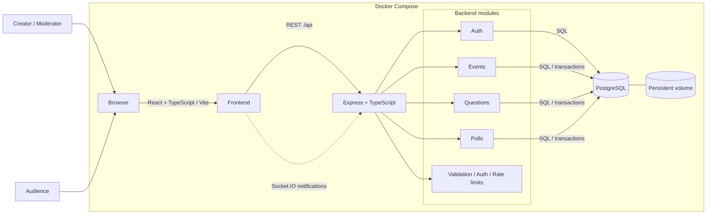

# Architecture Overview

Creator Interaction Hub is a small audience Q&A companion that runs alongside
an existing livestream. It does not host video or replace livestream chat.
The backend is a modular monolith; the frontend, API, and database run as
separate Docker Compose services.

## System

The frontend's Vite proxy forwards API and Socket.IO traffic to the backend.
PostgreSQL is the source of truth. Socket.IO signals changes; connected
clients reload current state through REST. If a socket disconnects, REST and
manual refresh remain available.

## Main choices

| Choice | Reason and trade-off |
| --- | --- |
| React + TypeScript; Node.js + Express + TypeScript | One language across the web stack with lightweight, familiar tools. |
| PostgreSQL | Relational constraints and transactions protect event ownership, question state, and poll votes. |
| Modular monolith | Clear domain boundaries without the deployment and operational cost of microservices. |
| REST plus Socket.IO | REST stays authoritative and testable; sockets improve responsiveness but are best-effort. |
| Docker Compose | Gives reviewers one local startup path and a persistent database without requiring cloud services. |
| Plain CSS, no UI framework | Matches the chosen high-contrast, tactile visual design and keeps styling explicit. |

## Product and data boundaries

- Creators register or sign in; protected operations verify event ownership
  on the backend. Audience members need no account.
- Questions begin as `PENDING`. Only `APPROVED` and `ANSWERED` questions are
  public; moderators control the allowed state transitions.
- Polls support one active poll per event. A unique database constraint
  rejects another vote with the same browser-issued key for that poll.
- Per-IP limits cover authentication, question submissions, and votes. They
  use in-memory counters suitable for this single-instance local demo, not
  distributed production traffic.
- The voter key discourages repeat voting in the same browser; it is not
  identity verification.

## Why the scope stays small

Q&A and moderation were completed before optional polls and voting. The
project excludes streaming integrations, audience accounts, Redis, Kafka,
Kubernetes, and separate services because they do not support the core
demonstration. Creator signup has no email verification or recovery flow.

## Other diagrams

The system diagram above is complemented by the existing [ER diagram in the
database design](./database-design.md#2-entity-relationship-diagram). The
[full architecture document](./architecture.md) also has a Q&A sequence
diagram and a Docker deployment diagram. Together, these show the component
boundaries, data relationships, main workflow, and runtime layout; duplicating
them here would add little.

## Further design material

- [Product requirements](./requirements.md) and [milestones](./milestones.md)
- [Full architecture](./architecture.md)
- [Database design](./database-design.md) and [API design](./api_design.md)
- [Design decisions](./design_decisions.md) and [frontend design](./frontend_design.md)
- [Testing strategy](./testing%20strategy.md) and [verified results](./reports/testing/manual-verification.md)
