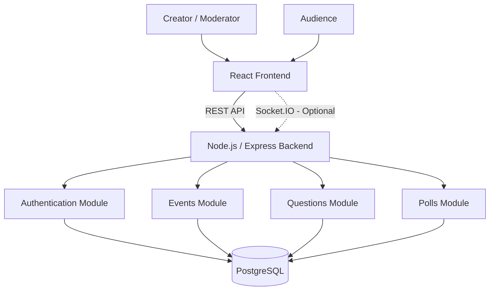
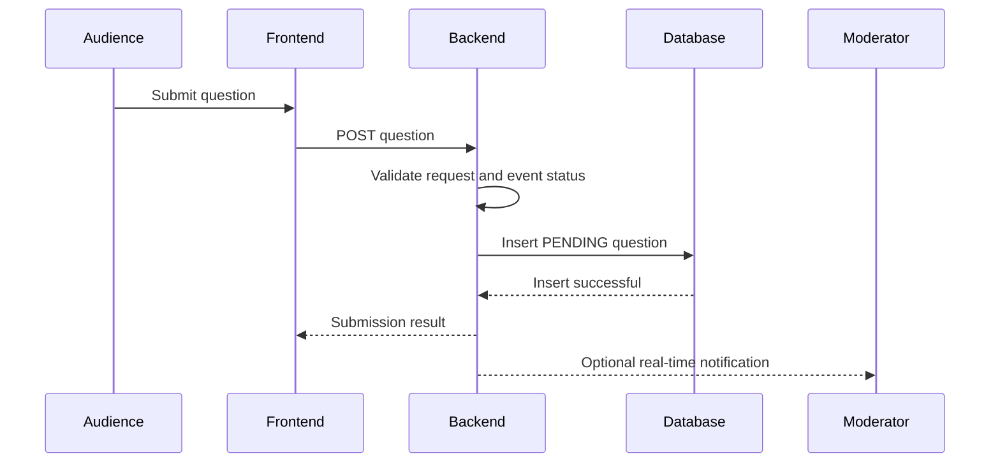
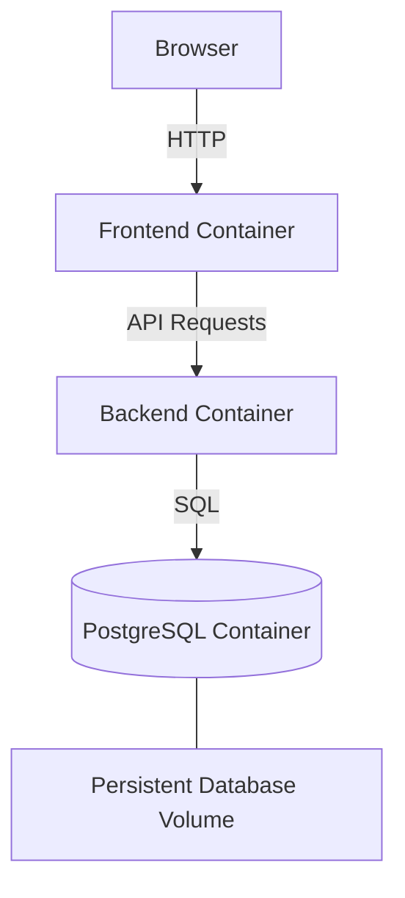

# Architecture

## 1. Overview

Creator Interaction Hub is designed as a small web application that allows livestream audiences to submit questions and lets creators moderate and organise them.

The system uses a **modular monolith architecture**. The frontend and backend are separate applications, while the backend contains logically separated modules within a single deployable service.

This approach keeps the project straightforward to develop, test, deploy, and maintain within the available development time.

### Technology Stack

| Layer                   | Technology                                |
| ----------------------- | ----------------------------------------- |
| Frontend                | React, TypeScript, Vite                   |
| Backend                 | Node.js, Express, TypeScript              |
| Database                | PostgreSQL                                |
| API                     | REST                                      |
| Real-time communication | Socket.IO (optional)                      |
| Validation              | Zod (or an equivalent validation library) |
| Testing                 | Vitest, Supertest                         |
| Containerisation        | Docker, Docker Compose                    |

## 2. High-Level Architecture

The application consists of three primary components:

1. **Frontend:** Provides the creator dashboard, moderation interface, and public audience interface.
2. **Backend:** Handles authentication, business rules, request validation, and communication with the database.
3. **Database:** Stores creator accounts, events, questions, polls, options, and votes.



The backend is the central authority for business rules and data access. The frontend must not be trusted to enforce permissions or workflow rules by itself.

## 3. Frontend Architecture

The frontend is responsible for rendering the user interface and communicating with the backend through API requests.

### Main interfaces

- **Creator Dashboard:** Lists the creator's events and provides event management actions.
- **Event Moderation Dashboard:** Displays submitted questions and provides moderation controls.
- **Public Event Page:** Allows audience members to view an event, submit questions, and see approved questions.
- **Poll Interface:** Creator poll management and public voting/results.

### Suggested structure

```text
frontend/
├── src/
│   ├── components/
│   ├── pages/
│   ├── features/
│   │   ├── auth/
│   │   ├── events/
│   │   ├── questions/
│   │   └── polls/
│   ├── services/
│   ├── hooks/
│   ├── types/
│   └── App.tsx
├── package.json
└── Dockerfile
```

The structure is intended as a starting point rather than a strict requirement. Avoid creating unnecessary layers or abstractions for a small application.

### Frontend responsibilities

- Display application state and user feedback.
- Perform basic form validation for usability.
- Call backend APIs.
- Handle loading, empty, success, and error states.
- Keep public and creator interfaces logically separated.
- Refresh data when real-time connections are unavailable.

Business rules and access control must remain on the backend.

## 4. Backend Architecture

The backend is implemented as a modular monolith using Express and TypeScript.

Each module is responsible for a specific domain of functionality.

### Main modules

| Module     | Responsibility                                                |
| ---------- | ------------------------------------------------------------- |
| Auth       | Creator authentication and session/token handling             |
| Events     | Event creation, ownership, and lifecycle                      |
| Questions  | Question submission, retrieval, and moderation                |
| Polls      | Poll creation, voting, lifecycle, and results                  |
| Realtime   | Optional Socket.IO events and room management                 |
| Database   | Database connection, migrations, and shared data access       |
| Middleware | Authentication, validation, error handling, and rate limiting |

### Suggested structure

```text
backend/
├── src/
│   ├── modules/
│   │   ├── auth/
│   │   ├── events/
│   │   ├── questions/
│   │   ├── polls/
│   │   └── realtime/
│   ├── middleware/
│   ├── database/
│   ├── config/
│   ├── app.ts
│   └── server.ts
├── tests/
├── package.json
└── Dockerfile
```

Individual modules may use routes, controllers, and services where appropriate.

Their intended responsibilities are:

- **Routes:** Define HTTP endpoints and connect them to handlers.
- **Controllers:** Handle HTTP requests and responses.
- **Services:** Implement business rules and coordinate operations.
- **Database layer:** Execute database queries and persistence operations.

Not every module needs a separate file for every layer. The implementation should remain proportionate to the actual complexity.

## 5. Request and Data Flow

### 5.1 Audience question submission

1. Audience member opens the public event page using its public code.
2. Frontend retrieves the event information from the backend.
3. Audience member submits a question and display name.
4. Backend validates the request and verifies that the event is active.
5. Backend creates a question with `PENDING` status in PostgreSQL.
6. Backend returns the submission result.
7. If real-time functionality is implemented, the backend notifies the authorised moderator room after the database operation succeeds.



### 5.2 Question moderation

1. Creator logs in and opens the moderation dashboard.
2. Frontend requests questions belonging to the creator's event.
3. Backend verifies authentication and event ownership.
4. Creator approves or rejects a pending question.
5. Backend validates the requested status transition.
6. Database is updated only if the transition is valid.
7. Public event viewers can see the question only after it has been approved.

A question must not become publicly visible merely because the frontend changes its displayed status.

## 6. Data Ownership and Business Rules

The backend is responsible for enforcing the following rules:

### Event lifecycle

- Events can have `DRAFT`, `ACTIVE`, or `ENDED` status.
- Only active events accept audience questions.
- Only the event owner can manage the event.
- An event can have at most one active poll.
- An active poll accepts votes only while its event is active.
- Ending an event closes its active poll.
- A unique `(poll_id, voter_key)` constraint prevents repeat votes with the
  same browser key.

### Question lifecycle

- New questions start as `PENDING`.
- Pending questions can become `APPROVED` or `REJECTED`.
- Approved questions can become `ANSWERED`.
- Rejected and pending questions are not visible through the public question API.
- Only authorised creators can moderate questions belonging to their events.

These rules must be enforced on the server, regardless of frontend behaviour.

## 7. Real-Time Communication

Socket.IO notifies moderators when new questions arrive and updates audience
views after question status changes, event lifecycle changes, and poll
updates. It is a best-effort notification layer rather than a dependency for
the REST workflow.

Suggested room structure:

- `event:{eventId}:moderators`
- `event:{eventId}:audience`

Moderator room access requires an authenticated creator and event ownership
verification. An audience client may join a public room only by supplying a
valid public event code; public rooms receive no private moderation data.

### Source of truth

PostgreSQL remains the source of truth.

- Database writes must succeed before corresponding notifications are emitted.
- Socket.IO messages are notifications, not the authoritative application state.
- Clients should retrieve the latest state through REST APIs after reconnecting.
- The application must remain usable if the real-time connection fails.
- Public room messages contain no pending/rejected questions or voter data.

## 8. Deployment Architecture

The application is designed to run locally using Docker Compose.



Suggested services:

| Service  | Responsibility             |
| -------- | -------------------------- |
| frontend | Runs the React application |
| backend  | Runs the Express API       |
| db       | Runs PostgreSQL            |

Docker Compose should configure the services, environment variables, networking, and persistent database volume.

The backend API port binds to loopback. Browser requests pass through the
Vite proxy, which forwards the originating client address for in-memory rate
limits. The backend trusts only this configured proxy hop in the Compose
topology.

The project does not require cloud deployment. A reviewer should be able to start the application locally using the documented Docker Compose command.

## 9. Architectural Principles and Trade-offs

### Modular monolith instead of microservices

A modular monolith is sufficient because the application has a small number of closely related features and does not require independent service scaling.

It reduces deployment complexity and allows the project to focus on business logic and maintainability.

### REST as the primary communication mechanism

REST provides a straightforward and testable interface between the frontend and backend.

Real-time communication can improve responsiveness, but it should not introduce a dependency that makes the application unreliable.

### PostgreSQL for persistence

The application contains related entities such as creators, events, questions, polls, and votes.

A relational database provides foreign keys, constraints, transactions, and structured queries that help preserve data integrity.

### No unnecessary infrastructure

Redis, Kafka, Kubernetes, and separate microservices are excluded because their complexity is not justified by the MVP requirements.

## 10. Design Constraints

The architecture is intentionally designed for a small MVP and has the following limitations:

- It assumes a single application backend.
- It does not provide large-scale distributed deployment.
- It does not integrate with external livestreaming platforms.
- Audience participation does not require account registration.
- Creator registration is open username/password signup without email
  verification or account recovery.
- A browser-issued participant key for poll voting is only a basic
  duplicate-vote deterrent, not reliable identity verification.
- Rate-limit counters are in memory and reset on backend restart; no
  distributed deployment is supported.
- Real-time delivery is best-effort; clients must be able to recover state through REST APIs.

These limitations are acceptable for the intended demonstration and can be reconsidered if the product scope changes.

## 11. Architecture Completion Criteria

The architecture is considered implemented when:

- Frontend, backend, and database run as separate application components.
- Frontend communicates with the backend through documented APIs.
- Backend modules have clear responsibilities.
- Business rules and permissions are enforced on the server.
- PostgreSQL persists application data.
- Docker Compose can start the complete application.
- The core workflow remains functional without Socket.IO.
- The implementation is understandable and can be explained by the developer.
