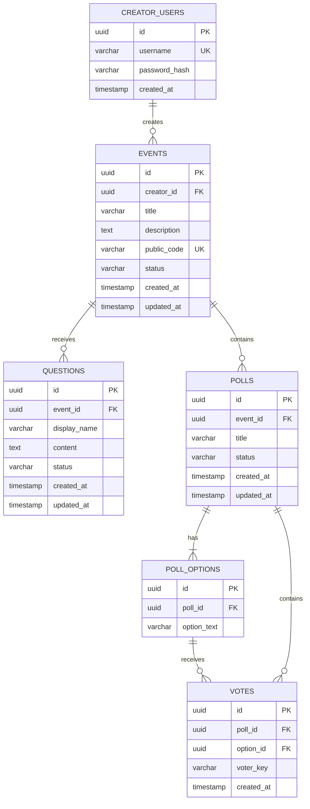

# Database Design

## 1. Overview

Creator Interaction Hub uses **PostgreSQL** as its primary relational database.

The database stores creator accounts, events, audience questions, polls, poll
options, and votes.

The design prioritises:

- Clear relationships between entities.
- Data integrity through foreign keys and constraints.
- Efficient retrieval of questions for moderation.
- Secure separation between public and creator-only information.
- Straightforward implementation and maintenance.

The database is designed for a small MVP rather than a large-scale distributed system.

## 2. Entity Relationship Diagram

The core database consists of three entities:

- `CreatorUsers`
- `Events`
- `Questions`

Poll-related entities are optional and should only be implemented if time permits.

Polls, options, and votes are part of the Milestone 5 application schema.

## 3. Table Definitions

### 3.1 CreatorUsers

Stores creator accounts that can manage events and moderate questions.

| Column | Type | Constraints | Description |
|---|---|---|---|
| id | UUID | Primary key, default `gen_random_uuid()` | Unique creator identifier |
| username | VARCHAR(100) | Unique, not null, check format | Login username |
| password_hash | TEXT | Not null | Securely hashed password |
| created_at | TIMESTAMPTZ | Not null, default `NOW()` | Account creation time |

Username format constraint: must be lowercase, trimmed, and between 1 and 100 characters.

Notes:

- Creator registration is public; usernames are normalized to lowercase and
  unique.
- A demo creator account can also be seeded for evaluation.
- Passwords must never be stored in plaintext.
- Authentication credentials must not be exposed through public APIs.

### 3.2 Events

Stores livestream-related audience participation events.

| Column | Type | Constraints | Description |
|---|---|---|---|
| id | UUID | Primary key, default `gen_random_uuid()` | Unique event identifier |
| creator_id | UUID | Foreign key, not null, `ON DELETE RESTRICT` | Event owner |
| title | VARCHAR(200) | Not null, check not empty | Event title |
| description | TEXT | Nullable | Event description |
| public_code | VARCHAR(32) | Unique, not null, check hex format | Public participation identifier |
| status | VARCHAR(20) | Not null, default `'DRAFT'`, check valid values | Event lifecycle status |
| created_at | TIMESTAMPTZ | Not null, default `NOW()` | Creation time |
| updated_at | TIMESTAMPTZ | Not null, default `NOW()` | Last update time |

Allowed event statuses:

- `DRAFT`
- `ACTIVE`
- `ENDED`

Business rules:

- Each event belongs to one creator.
- A creator can own multiple events.
- Public access uses `public_code`, rather than exposing internal creator information.
- Only active events accept new questions.
- Only the event owner can manage the event.

### 3.3 Questions

Stores audience-submitted questions.

| Column | Type | Constraints | Description |
|---|---|---|---|
| id | UUID | Primary key, default `gen_random_uuid()` | Unique question identifier |
| event_id | UUID | Foreign key, not null, `ON DELETE CASCADE` | Associated event |
| display_name | VARCHAR(80) | Not null, check not empty | Audience display name |
| content | TEXT | Not null, check not empty | Submitted question |
| status | VARCHAR(20) | Not null, default `'PENDING'`, check valid values | Moderation status |
| created_at | TIMESTAMPTZ | Not null, default `NOW()` | Submission time |
| updated_at | TIMESTAMPTZ | Not null, default `NOW()` | Last status update |

Allowed question statuses:

- `PENDING`
- `APPROVED`
- `REJECTED`
- `ANSWERED`

Allowed status transitions:

| Current status | Allowed next status |
|---|---|
| PENDING | APPROVED |
| PENDING | REJECTED |
| APPROVED | ANSWERED |
| REJECTED | None |
| ANSWERED | None |

Business rules:

- Every question belongs to one event.
- New questions must start with `PENDING`.
- Only authorised creators can moderate questions.
- Public APIs must only return `APPROVED` and `ANSWERED` questions.
- Questions cannot be submitted to events that are not active.

The backend must enforce these rules. Database constraints should enforce the basic allowed status values, while application logic validates status transitions.

### 3.4 Schema Migrations

Tracks which SQL migration files have been applied to the database, ensuring migrations are applied exactly once.

| Column | Type | Constraints | Description |
|---|---|---|---|
| name | TEXT | Primary key | Migration file name |
| applied_at | TIMESTAMPTZ | Not null, default `NOW()` | Time the migration was applied |

Migrations are executed inside a transaction alongside the schema change, so a migration is either fully applied or not applied at all.

## 4. Optional Poll Tables

The following tables store poll data.

### 4.1 Polls

| Column | Type | Constraints | Description |
|---|---|---|---|
| id | UUID | Primary key | Unique poll identifier |
| event_id | UUID | Foreign key, not null | Associated event |
| title | VARCHAR(200) | Not null | Poll question or title |
| status | VARCHAR(20) | Not null | Poll lifecycle status |
| created_at | TIMESTAMPTZ | Not null, default `NOW()` | Creation time |
| updated_at | TIMESTAMPTZ | Not null, default `NOW()` | Last update time |

Allowed statuses:

- `DRAFT`
- `ACTIVE`
- `CLOSED`

An event can have at most one active poll. A partial unique index on
`polls(event_id) WHERE status = 'ACTIVE'` enforces this even if application
requests race.

### 4.2 PollOptions

| Column | Type | Constraints | Description |
|---|---|---|---|
| id | UUID | Primary key | Unique option identifier |
| poll_id | UUID | Foreign key, not null | Associated poll |
| option_text | VARCHAR(200) | Not null | Option label |
| position | INTEGER | Not null, non-negative | Display order |

A poll contains 2–6 distinct options. Each option belongs to one poll. The
backend validates the count and case-insensitive distinctness when creating
the poll. A unique `(poll_id, id)` key supports the vote option relationship.

### 4.3 Votes

| Column | Type | Constraints | Description |
|---|---|---|---|
| id | UUID | Primary key | Unique vote identifier |
| poll_id | UUID | Foreign key, not null | Associated poll |
| option_id | UUID | Foreign key, not null | Selected option |
| voter_key | VARCHAR(128) | Not null | Browser-issued participant key |
| created_at | TIMESTAMPTZ | Not null, default `NOW()` | Vote submission time |

Important constraints:

- A unique constraint on `(poll_id, voter_key)` prevents the same browser-issued key from voting multiple times in one poll.
- A composite foreign key `(poll_id, option_id)` references the same pair on
  `poll_options`, ensuring the selected option belongs to that poll.
- A unique `(poll_id, position)` constraint preserves option order.
- Votes are accepted only while both the poll and its event are active.

The browser-issued key is only a basic duplicate-vote deterrent. It is not reliable identity verification and can be bypassed by clearing browser data or using another browser/device.

## 5. Relationships and Referential Integrity

The main relationships are:

| Relationship | Cardinality | Explanation |
|---|---|---|
| CreatorUsers → Events | One-to-many | One creator can create multiple events |
| Events → Questions | One-to-many | One event can receive multiple questions |
| Events → Polls | One-to-many | One event can contain multiple polls |
| Polls → PollOptions | One-to-many | One poll contains multiple options |
| Polls → Votes | One-to-many | One poll receives multiple votes |
| PollOptions → Votes | One-to-many | One option can receive multiple votes |

Foreign keys should prevent records from referencing nonexistent parent entities.

For the MVP, deletion behaviour is enforced by foreign keys:

- Creator deletion is restricted while owned events exist (`ON DELETE RESTRICT`).
- Deleting an event cascades to its questions (`ON DELETE CASCADE`), preventing orphaned records.
- Prefer implementing event ending over event deletion if deletion is not necessary.

## 6. Constraints and Indexing

### 6.1 Recommended constraints

| Table | Constraint | Purpose |
|---|---|---|
| CreatorUsers | Unique username | Prevent duplicate accounts |
| CreatorUsers | Check username format | Must be lowercase, trimmed, 1–100 characters |
| Events | Unique public_code | Ensure public event codes are unique |
| Events | Foreign key creator_id | Ensure valid event ownership, `ON DELETE RESTRICT` |
| Events | Check title not empty | Trimmed title must be 1–200 characters |
| Events | Check public_code format | Must match `^[a-f0-9]{32}$` |
| Events | Check status valid | Must be `DRAFT`, `ACTIVE`, or `ENDED` |
| Questions | Foreign key event_id | Ensure valid event association, `ON DELETE CASCADE` |
| Questions | Check status valid | Must be `PENDING`, `APPROVED`, `REJECTED`, or `ANSWERED` |
| Questions | Check display_name not empty | Trimmed name must be 1–80 characters |
| Questions | Check content not empty | Trimmed content must be 1–2000 characters |
| Polls | Partial unique index on event_id where status is ACTIVE | At most one active poll per event |
| Poll options | Unique poll_id + position | Preserve option display order |
| Votes | Unique poll_id + voter_key | Prevent duplicate votes using the same key |

Use a composite foreign key to ensure that the selected option belongs to the
specified poll.

### 6.2 Recommended indexes

| Table | Index | Reason |
|---|---|---|
| CreatorUsers | Unique index on username | Efficient login lookup |
| Events | Unique index on public_code | Efficient public event lookup |
| Events | Index `events_creator_id_idx` on creator_id | Retrieve a creator's events |
| Questions | Composite index `questions_event_status_created_idx` on (event_id, status, created_at) | Retrieve and filter event questions efficiently |
| Polls | Index on event_id | Retrieve polls belonging to an event |
| Polls | Partial unique index on event_id where status is ACTIVE | At most one active poll per event |
| Votes | Unique index on (poll_id, voter_key) | Enforce duplicate-vote protection |

The composite question index supports the moderator dashboard, which commonly retrieves questions for a particular event filtered by status and ordered by submission time.

Avoid adding indexes without a query or constraint that justifies them.

## 7. Transactions and Data Integrity

Some operations involve multiple validation or database steps. These should be handled carefully to avoid inconsistent state.

### 7.1 Question submission

The backend should:

1. Resolve the event using its public code.
2. Verify that the event is active.
3. Validate the submitted display name and question content.
4. Insert the question with `PENDING` status.

The event status check and insertion should be protected against a concurrent event-ending operation. Use a transaction with appropriate locking or conditional database operations.

### 7.2 Question moderation

The backend should:

1. Verify creator authentication.
2. Verify that the question belongs to an event owned by that creator.
3. Validate the requested status transition.
4. Update the question only if its current status permits the transition.

A conditional update can help prevent conflicting status changes from concurrent requests.

### 7.3 Poll creation and voting

If polls are implemented:

- Creating a poll and its options should be atomic.
- Only active events can have an active poll accept votes.
- Voting should validate that the selected option belongs to that poll.
- A unique constraint on `(poll_id, voter_key)` should enforce duplicate-vote protection.
- The backend should handle uniqueness conflicts gracefully.
- Ending an event closes its active poll in the same transaction.

## 8. Data Access and API Exposure

The database schema does not determine which fields should be exposed to users.

The backend must explicitly select and return the fields appropriate to each API.

For example:

**Public event response:**
- Event title
- Event description
- Public code
- Event status

**Public question response:**
- Question ID
- Display name
- Question content
- Question status
- Submission time

**Creator-only response:**
- All questions belonging to the creator's event, including pending and rejected questions.

Creator credentials, password hashes, internal ownership information, and other unnecessary internal fields must not be exposed through public APIs.

## 9. Migration and Seed Data

Database schema changes should be managed through migrations rather than relying on manual database modifications. A `schema_migrations` table tracks which migration files have been applied, ensuring each migration runs exactly once inside a transaction.

The project should provide:

- Initial schema migration (`001_initial_schema.sql`).
- A repeatable development/demo seed process using environment-provided creator credentials.
- A demo creator account.
- Optional sample event and questions for evaluation.

Seed credentials should be documented for local evaluation only and must not be reused as production credentials.

The database should use a persistent Docker volume so application restarts do not erase stored data.

## 10. Database Design Completion Criteria

The database design is considered implemented when:

- Core tables and relationships are created.
- Primary keys and foreign keys are defined.
- Required unique and check constraints are applied.
- Question retrieval indexes are created.
- Event ownership and question lifecycle rules are enforced by the backend.
- Database migrations can initialise a clean database.
- Seed data supports the demo workflow.
- Core application data persists after restarting Docker Compose.
- Poll tables, constraints, and indexes are installed by a versioned migration.